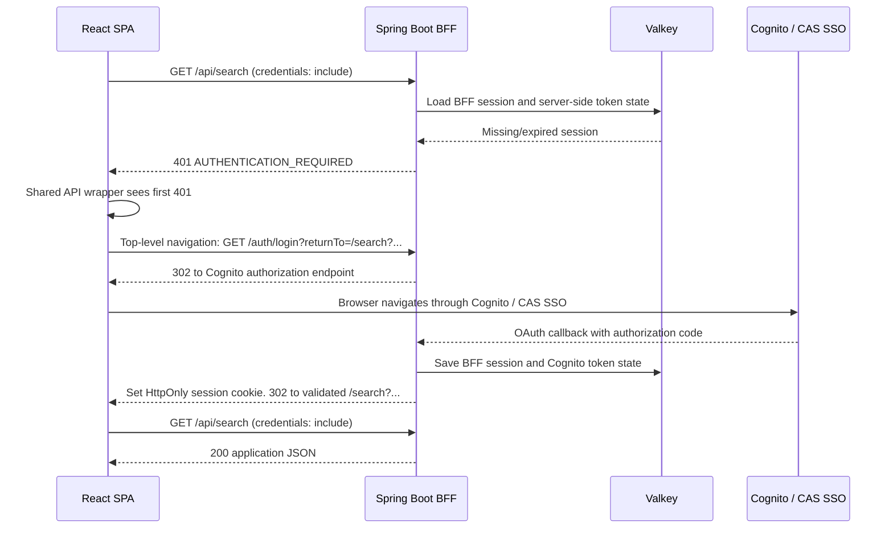

# React-to-BFF Authentication Integration Guide

## Purpose

The React application calls only the Spring Boot BFF. It does **not** call AWS Cognito directly, handle OAuth/OIDC redirects, read/store JWTs, refresh tokens, or add `Authorization: Bearer` headers.

The BFF owns Cognito/CAS federation, OAuth authorization-code exchange, JWT storage and refresh, and the Valkey-backed server-side session. The browser holds only the opaque BFF session cookie.

React has one authentication responsibility: when a protected BFF API returns `401 Unauthorized`, perform one **top-level browser navigation** to the BFF login entry point.

## API Contract

### Normal request

All protected BFF calls must include browser credentials:

```ts
fetch("/api/...", {
  credentials: "include"
});
```

With a valid BFF session, the BFF retrieves the server-held Cognito access token, calls downstream APIs as needed, and returns application-safe JSON to React.

### Unauthenticated request

If the BFF session is missing, expired, invalid, or its server-held token cannot be refreshed, the BFF returns:

```http
HTTP/1.1 401 Unauthorized
Content-Type: application/problem+json
Cache-Control: no-store

{
  "type": "https://app.mydomain.com/problems/authentication-required",
  "title": "Authentication required",
  "status": 401,
  "code": "AUTHENTICATION_REQUIRED"
}
```

React must not expect an OAuth redirect response from `/api/**` calls. The BFF intentionally returns `401` for API/fetch requests.

A `403 Forbidden` is different: it means the user is authenticated but lacks access. React should display an authorization error; it must not start login for `403`.

## Why React Must Navigate

OAuth/Cognito login requires a top-level browser navigation through multiple redirects:

```text
React browser → BFF /auth/login → Cognito → CAS (if configured) → Cognito → BFF callback → React route
```

A background `fetch()` request cannot reliably initiate this browser-visible login flow. A redirect returned to `fetch()` may be followed in the background and result in unexpected HTML/CORS behavior rather than navigating the current page.

React does not need to know Cognito URLs, CAS, OAuth, PKCE, tokens, or the BFF callback URL. It only navigates to the BFF-owned login endpoint.

## Required React Implementation

### 1. Use one shared API wrapper

All BFF requests should use one wrapper (or a single Axios interceptor). Do not put auth logic in individual screens/components.

```ts
let loginInProgress = false;

function currentLocalRoute(): string {
  return (
    window.location.pathname +
    window.location.search +
    window.location.hash
  );
}

function beginLoginOnce(): void {
  if (loginInProgress) {
    return;
  }

  loginInProgress = true;

  const returnTo = encodeURIComponent(currentLocalRoute());
  window.location.assign(`/auth/login?returnTo=${returnTo}`);
}

export async function bffFetch(
  input: RequestInfo | URL,
  init: RequestInit = {}
): Promise<Response> {
  const response = await fetch(input, {
    ...init,
    credentials: "include",
    headers: {
      Accept: "application/json",
      ...init.headers,
    },
  });

  if (response.status === 401) {
    beginLoginOnce();
    throw new Error("Authentication required; BFF login navigation started");
  }

  return response;
}
```

All callers use `bffFetch()` rather than raw `fetch()`:

```ts
const response = await bffFetch("/api/search?q=foobar");
const data = await response.json();
```

### 2. Handle error categories correctly

| BFF response | React behavior |
|---|---|
| `200–299` | Process normal application payload |
| `401` | Start one top-level navigation to `/auth/login`; do not retry the API call |
| `403` | Show "not authorized" state; do not initiate login |
| `400`, `404`, `409`, `422` | Handle as normal application/API errors |
| `429` | Apply the app's retry/backoff UX if appropriate |
| `5xx`, timeout, network error | Show retry/error UX; do not initiate login unless the BFF specifically returned `401` |

## Thundering-Herd Protection

### The scenario

At application startup, multiple components may make protected asynchronous calls simultaneously:

```text
/api/me
/api/dashboard
/api/notifications
/api/search
/api/preferences
```

If no BFF session exists, all can receive `401`.

### React requirements

- Use the shared `loginInProgress` guard shown above.
- The first completed `401` starts `window.location.assign("/auth/login?..." )`.
- All later `401` responses during that page lifetime must do nothing beyond failing their local request.
- Do not attempt multiple login navigations.
- Do not retry unauthenticated requests before login completes.

### Recommended startup gate

Avoid the herd proactively:

1. On React bootstrap, call `GET /api/session` or `GET /api/me` using `bffFetch()`.
2. Do not render authenticated routes or enable React Query/SWR data queries until it returns `200`.
3. If it returns `401`, login navigation begins once.
4. Once the session check succeeds, render the authenticated app and allow protected calls.

Illustrative bootstrap logic:

```ts
async function initializeSession() {
  const response = await bffFetch("/api/session");
  return response.json();
}
```

The BFF handles a separate server-side token-refresh herd with a Valkey-backed single-flight/lock mechanism. React does not manage refresh tokens.

## `returnTo` Behavior

### Why React sends it

`returnTo` preserves the exact SPA location after the user completes login.

If the current browser URL is:

```text
https://app.mydomain.com/search?q=foobar&page=4&sort=recent
```

React generates:

```text
/auth/login?returnTo=%2Fsearch%3Fq%3Dfoobar%26page%3D4%26sort%3Drecent
```

After successful login, the BFF validates this local path, creates the session, and redirects the browser back to:

```text
/search?q=foobar&page=4&sort=recent
```

### What React must send

Build it only from browser location state:

```ts
const returnTo =
  window.location.pathname +
  window.location.search +
  window.location.hash;
```

Then URL-encode it once when placing it in the login URL.

Do not send an absolute URL, Cognito URL, CAS URL, token, user identifier, or arbitrary external redirect.

### BFF responsibility

The BFF, not React, validates `returnTo`. It accepts only local relative SPA paths and rejects external/ambiguous destinations such as:

```text
https://evil.example/    rejected
//evil.example/          rejected
/\\evil.example/         rejected
javascript:...           rejected
```

React should treat `returnTo` as a convenience for deep-link restoration, not a security mechanism.

## Login Flow



## Non-requirements for React

React must not:

- Store, decode, refresh, or forward Cognito JWTs.
- Call Cognito directly.
- Build Cognito authorization URLs.
- Handle CAS tickets, SAML assertions, OAuth `state`, PKCE, or authorization codes.
- Inspect the BFF session cookie.
- Turn a `403` into a login redirect.
- Retry a `401` API request in a loop.

## Integration Checklist

- [ ] All BFF API requests use `credentials: "include"`.
- [ ] All BFF API requests go through `bffFetch()` or one Axios interceptor.
- [ ] First `401` starts exactly one `window.location.assign("/auth/login?returnTo=...")` navigation.
- [ ] Later concurrent `401`s do not start another navigation.
- [ ] React boot checks `/api/session` or `/api/me` before starting protected data queries.
- [ ] `403` produces an authorization UX, not login.
- [ ] `5xx` and network failures produce resilience/error UX, not login.
- [ ] `returnTo` comes only from `pathname + search + hash` and is URL-encoded once.
- [ ] No JWT/OAuth/Cognito/CAS behavior is added to React.
